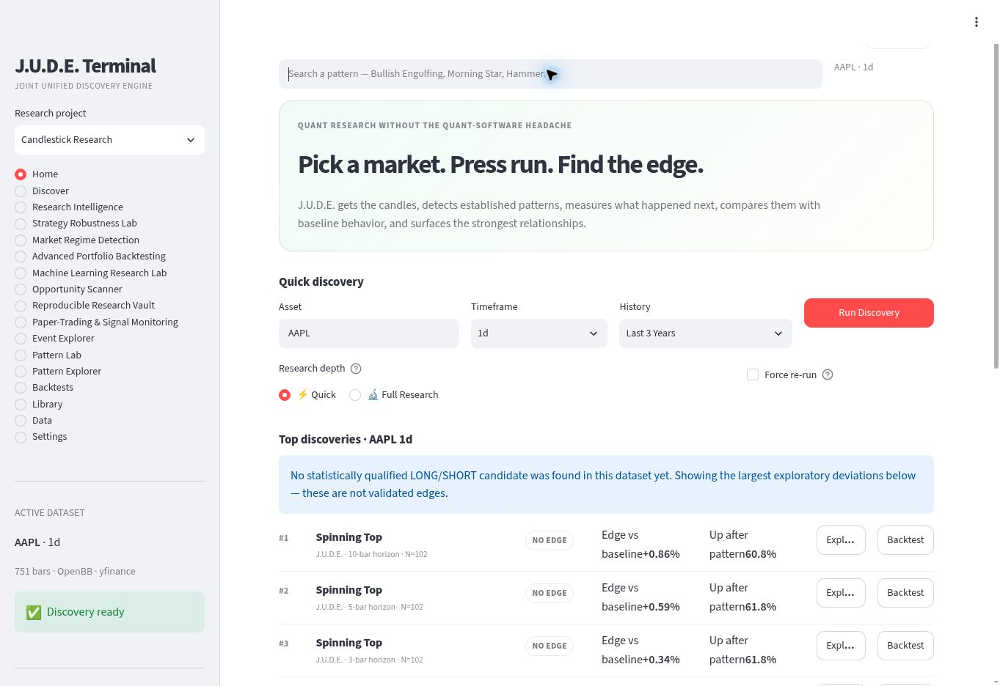
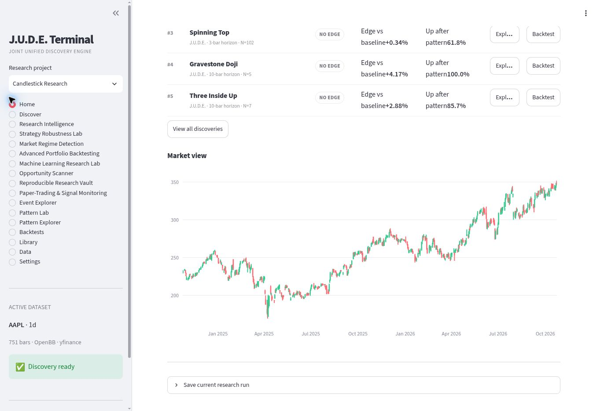
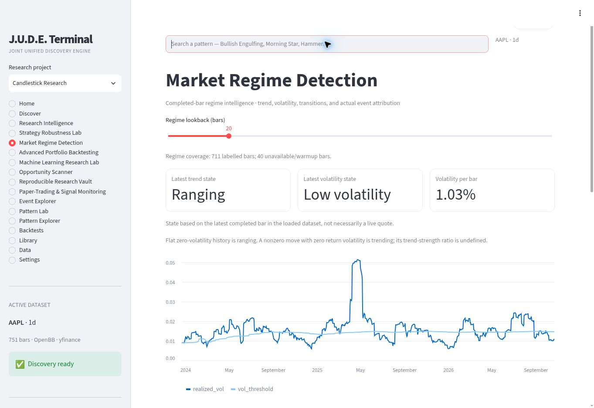

# J.U.D.E. Terminal

**Joint Unified Discovery Engine**  
A quantitative research terminal by **Jude Ramcharitar**.

Explore historical market behavior, examine parameter stability, and carry research evidence through validation, comparison, archiving, and paper simulation.

**[Open the live terminal](https://j-u-d-e-terminal.onrender.com/)** · [Architecture](docs/ARCHITECTURE.md) · [Methodology](docs/METHODOLOGY.md) · [Validation](docs/VALIDATION.md) · [30-second walkthrough](demo/walkthrough.mp4)



## What this repository contains

This is the public showcase for a working application. It contains screenshots, a captioned screenshot walkthrough, technical documentation, and a standalone example of completed-outcome windowing. The production application's implementation and development history remain private. This repository does not contain the application source or run a local copy of the terminal.

## Eight connected research modules

| Module | What it does |
| --- | --- |
| Research Intelligence | Explains measured studies, evidence checks, assumptions, and useful follow-up diagnostics. |
| Strategy Robustness Lab | Tests horizon/cost sensitivity, detector parameters, chronological behavior, and event-removal stress. |
| Market Regime Detection | Labels historical trend/volatility states and examines transitions, sensitivity, and event attribution. |
| Advanced Portfolio Backtesting | Simulates historical execution with cash/share accounting, costs, exposure controls, and reconciliation. |
| ML Research Lab | Compares baseline and fitted models with chronological evaluation, experiment records, and final-sample protocols. |
| Opportunity Scanner | Applies explicit evidence and research-review gates to historical studies. |
| Research Vault | Prepares checksummed research archives, histories, and optional saved records. |
| Paper Simulation | Replays delayed historical fills, tracks simulated positions, and checks account arithmetic and lifecycle. |

## Dynamic historical robustness surfaces

The robustness lab can recalculate surfaces across rolling historical windows. Play/Pause, a timeline, speed selection, and reference-period comparison help inspect how measured behavior changes through time. Parameter, dataset, and regime changes recalculate the underlying results.

Interpolation smooths display geometry between calculated frames. It does not create financial observations. Unsupported parameter cells remain gaps, and historical playback is labelled separately from live market updates.

## A research workflow

1. Load public market history or a non-confidential example dataset.
2. Run discovery and inspect sample size, assumptions, and evidence.
3. Explore robustness and historical market regimes.
4. Compare portfolio or ML research scenarios with chronological checks.
5. Export research records and inspect a historical paper simulation.

The screenshots show an AAPL daily-history session, including cases where the evidence does **not** qualify a candidate. The example is a demonstration of the workflow, not a trading recommendation.



## Engineering

Python · Streamlit · Plotly · pandas · NumPy · DuckDB · OpenBB/yfinance



The application separates provider access, normalized historical data, research calculations, evidence checks, visualization, and optional storage. Its interfaces surface insufficient samples and unavailable evidence. Read the [architecture](docs/ARCHITECTURE.md) and [methodology](docs/METHODOLOGY.md) for the public technical overview.

### Standalone code example

[Completed-window example](examples/completed_windows.py) demonstrates a generic safeguard: an observation is eligible only when its forward outcome finishes by the window's historical cutoff. It contains no detector rules, trading signals, trained models, or production engine code. Python 3.11+ is sufficient; no third-party packages are required.

```bash
python examples/completed_windows.py
python -m unittest discover -s examples -p 'test_*.py' -v
```

## Validation snapshot

The private source application passed **1,900 offline tests**, with 1 skipped and 4 network tests deselected, for its October 25, 2026 release. Compilation, imports, server startup/health, and separate live-provider smoke checks passed. Desktop browser workflows were exercised, and the creator reviewed the updated dynamic preview.

Those 1,900 tests belong to the private source application and are not distributed or reproduced by this showcase. The example tests here cover only the standalone sample. See [validation scope](docs/VALIDATION.md), including WebGL/mobile coverage limits.

## Try the hosted demo

Open the [live terminal](https://j-u-d-e-terminal.onrender.com/), choose an asset and history, and press **Run Discovery**. For playback, open **Strategy Robustness Lab** after loading data and enable historical playback. Use a WebGL-capable browser for 3D charts. Sparse studies may correctly show unsupported cells; try a more frequently observed pattern or a longer window.

The free hosted instance can take time to wake. It uses temporary server storage and is a shared demonstration environment: use public or non-confidential example data. Download important exports. Redeployments or instance replacement can lose saved server records, and exports do not fully restore every ML protocol or saved account state.

## Project scope

J.U.D.E. supports historical research and simulation. Software tests, historical averages, and attractive backtests do not establish future profitability. Borrowing, execution, data quality, and scenario assumptions remain relevant to interpreting results.

[Report a reproducible issue](CONTRIBUTING.md) · [Security reporting](SECURITY.md) · [Content notice](NOTICE.md)

Created by **Jude Ramcharitar** · [GitHub profile](https://github.com/juderamcharitar)
