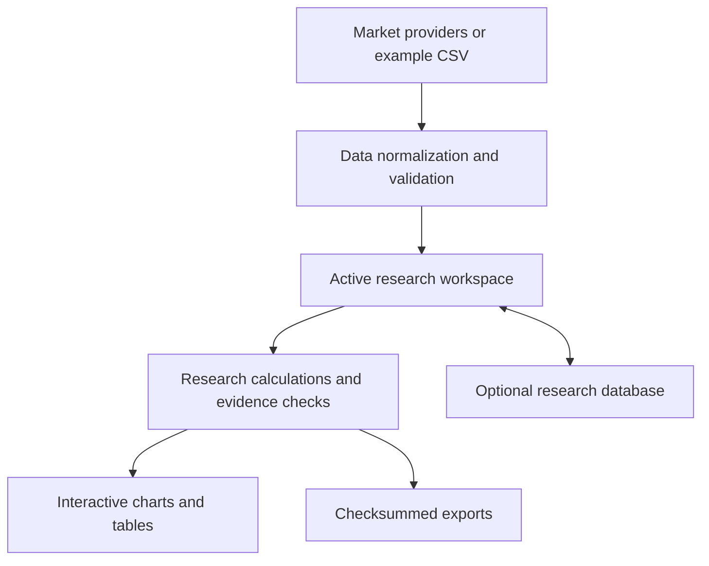

# Architecture

J.U.D.E. is a Python research application with a Streamlit interface. This document describes the major boundaries without publishing strategy implementation, production configuration, or private development history.

## Data and state

Market-data adapters obtain historical bars. The data boundary checks schema, ordering, timestamps, and price validity before calculations consume the active dataset. Research results are associated with input identity and settings so revised data do not silently reuse old evidence.

Browser-session state supports interactive exploration. Optional database records support explicit save/retrieve workflows. Session recovery and survival across a hosting redeployment are different properties; the free hosted instance does not provide a durable-retention guarantee.

## Research and evidence

Research modules consume normalized historical inputs and produce measured tables, coverage information, diagnostics, and descriptive assessments. Evidence gates distinguish missing, insufficient, blocked, and qualified research states. A submitted scenario is kept separate from draft controls until an explicit rerun where appropriate.

Independent reconciliation checks compare reported outcomes with active-bar arithmetic or execution/account records. The interface presents exclusions and assumptions alongside results.

## Dynamic surfaces

A rolling-frame calculation layer reuses the existing robustness calculations on historical slices. Forward outcomes must finish within the slice's cutoff. Event-time regime filters retain the underlying price timeline rather than shortening holding horizons.

Calculated frames are cached against data, settings, and calculation identity. Playback, scrub, speed, and period-comparison controls operate in the browser after calculation. Fixed scales support comparison. Interpolation affects display geometry only; exports contain calculated cells.

## Public example boundary

The standalone sample in this repository demonstrates completed-outcome window scheduling only. It does not reproduce the application's event detection, statistics, ML fitting, execution engine, registry, or storage implementation.
